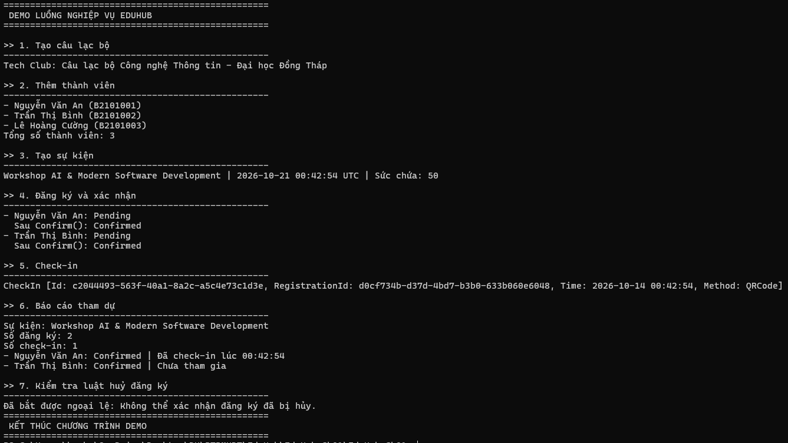

# EduHub — Ch01: Domain Modeling

Bài làm sinh viên Ch01 (HĐ1.3), triển khai dựa trên mẫu giảng viên trong thư mục `solution`. Domain gồm 5 class: `Member`, `Club`, `Event`, `Registration`, `CheckIn`.

## Thiết kế

- Mỗi class dùng `private set`, constructor private và factory `Create(...)` có kiểm tra dữ liệu đầu vào.
- Danh sách thành viên của `Club` chỉ đọc (`IReadOnlyList`); muốn thêm phải gọi `AddMember`.
- Luật nghiệp vụ nằm trong class: `Registration.Confirm()` chỉ hợp lệ khi Pending, Cancelled là trạng thái cuối,
  `CheckIn.Create()` chỉ cho phiếu Confirmed.
- `MemberStatus` là enum. Trạng thái phiếu và hình thức điểm danh dùng hằng chuỗi trong static class (`RegistrationStatus`, `CheckInMethod`), đúng như mẫu giảng viên.
- Tài liệu phân tích: `docs/user-stories.md`, `docs/class-diagram.md`.

## Chạy

Yêu cầu .NET SDK 10. Từ thư mục repo `EduHub`:

```powershell
dotnet build EduHub.Ch01/EduHub.Ch01.slnx
dotnet run --project EduHub.Ch01/EduHub.Ch01/EduHub.Ch01.csproj
```

Nếu terminal đang ở thư mục chứa `EduHub.Ch01.csproj`, chỉ cần `dotnet run`. Với Visual Studio, mở `EduHub.Ch01/EduHub.Ch01.slnx` rồi nhấn `Ctrl+F5`.

Chương trình chạy luồng: tạo CLB, thêm 3 thành viên, tạo sự kiện, đăng ký, xác nhận, check-in, báo cáo tham dự,
rồi minh hoạ một luật nghiệp vụ (phiếu đã huỷ không thể xác nhận lại).

Kết quả mong đợi: 3 thành viên, 2/50 lượt đăng ký, 1 lượt check-in và ngoại lệ khi xác nhận phiếu Cancelled được bắt ở bước 8. ID và thời gian thay đổi theo lần chạy.

## Ảnh demo

Ảnh dưới đây thuộc phiên bản demo cũ (7 bước). Phiên bản hiện tại tách đăng ký và xác nhận thành hai bước, tổng cộng 8 bước; cần chụp lại khi chuẩn bị nộp bài.


